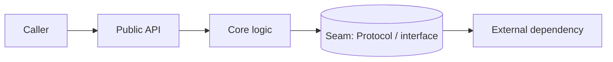
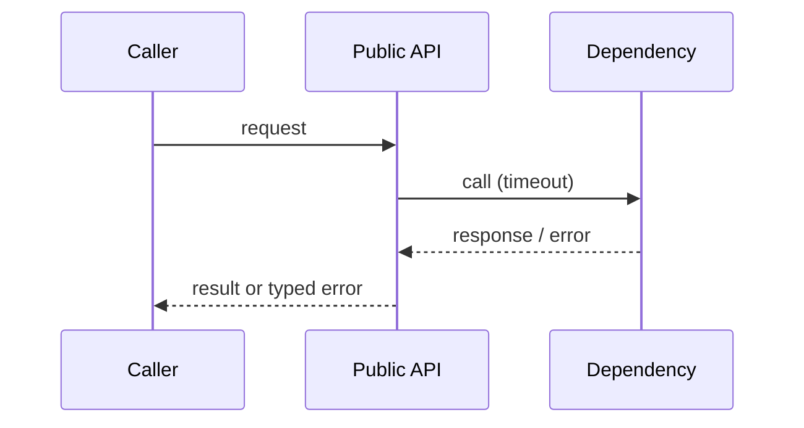

# Project docs: README.md + ARCHITECTURE.md (always, every mode)

Every `/craft` run leaves both files at the project root, in `showcase`, `standard` and `quick` modes alike.
Write them after the code settles (phase 6), from the code as it is, never from the plan. Docs are claims:
every command in them is run before the wrap, and every box in the diagram is a real module.
Keep them short: README ≤ 1 screen of essentials plus reference tables; ARCHITECTURE ≤ 2 screens.
If a file already exists, update it in place instead of replacing it.

## README.md
~~~markdown
# <name>

<1–2 lines: what it is and who it's for. The problem it solves.>

## Features
- <3–6 bullets: behaviors that matter, incl. the NFRs delivered (e.g. "honors Retry-After across threads")>

## Install
<exact commands, e.g. `uv sync`, `npm ci`; prerequisites + versions (Python ≥3.12 / Node ≥20)>

## Usage
<the smallest working example: code snippet or CLI call with its real output>
<configuration: env vars / options table (name, default, meaning). Secrets only via env, never inline.>

## Test
<exact commands for tests, coverage, lint, types, e.g. `uv run pytest --cov`, `uv run ruff check .`, `uv run mypy`>

## Run
<how to run it for real (CLI, server, demo script) and what you should see>

## Limitations / not built
<what was deliberately left out, and the next step for each>

See [ARCHITECTURE.md](ARCHITECTURE.md) for how it works.
~~~

## ARCHITECTURE.md
~~~markdown
# <name>: architecture

## Overview
<3–5 lines: the shape of the system, its main responsibility split, key constraints (quota, latency, n).>

## Components

| Component | File(s) | Responsibility |
|---|---|---|
| <box> | `src/...` | <one line> |

## Main flow

<Then 1 line per non-happy path: retry, timeout, rejection, partial failure.>

## Key decisions
| Decision | Why | Alternative rejected |
|---|---|---|
| <e.g. token bucket shared across threads> | <tied to the NFR budget> | <option B + why not> |

## NFRs
<one line per lens at basic/critical: where in the code it lives.>

## Extension points
<seam → the likely change it absorbs (named, not built).>
~~~

## Rules
- Diagrams are Mermaid (render on GitHub/GitLab and in most IDEs). Boxes = real modules/classes; arrows = real calls or data flows. No aspirational components.
- One component diagram + one sequence diagram for the main flow. Add a second sequence diagram only for a flow a reviewer would otherwise get wrong (e.g. retry/cooldown, batch fan-out).
- Every command in the README is executed before the wrap; paste real output where the README shows output.
- The design note (`DESIGN.md`) is the plan; ARCHITECTURE.md is the as-built. If they disagree, ARCHITECTURE.md follows the code, and the wrap says what changed.
