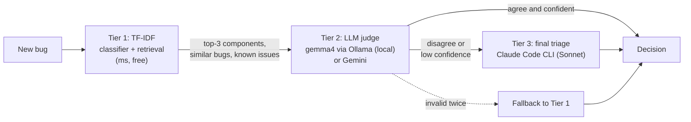

# bug-triage

A mock 3-tier bug-triage agent (TF-IDF classifier and retrieval, LLM judge with RAG context,
final triage by a stronger LLM) plus an evaluation harness that reports per-tier error rates.
**All data is invented:** the product ("Larkspur"), teams, developers, components, known issues
and bugs are fictional and generated by `scripts/generate_data.py`.

## Architecture



| Tier | What it does | Cost / latency |
|---|---|---|
| **1. TF-IDF** (`tier1_tfidf.py`) | Logistic regression over word 1–2 grams → top-3 components; owner team and default assignee from the ownership map. Cosine retrieval over past bugs (duplicates) and known issues. | free, ~1 ms |
| **2. Judge** (`judge.py`, `llm/`) | One structured-output call with RAG context: the bug, Tier-1 candidates, similar past bugs with their *confirmed* triage, known issues, the team roster. Output is schema- and KB-validated (unknown names rejected, team corrected to the component owner); one retry with the error fed back, then fallback to Tier 1. | local model, seconds |
| **3. Final** (`final_claude.py`) | `claude -p --model sonnet --tools "" --output-format json --json-schema …`, called only when Tier 1 and the judge disagree or the judge's confidence is below 0.7 (`--final on-disagreement`). | paid, ~5–10 s |

Design points:
- **Cost tiering:** the expensive model only sees the bugs the cheap tiers disagree on.
- **No hallucinated owners:** every name is checked against the ownership map before it's accepted.
- **Untrusted input:** the bug text is delimited as data and the prompts tell the model to ignore instructions
  inside it. The final tier runs with all tools disabled.
- **Thresholds tuned on history, not on the eval set:** duplicate ≥ 0.9 and known issue ≥ 0.4 cosine.

## Run

```bash
uv venv --python 3.12 && uv pip install -e ".[dev]"     # add ".[gemini]" for the Gemini judge
ollama pull gemma4:12b                                    # local judge
python scripts/generate_data.py                           # regenerate the invented data (deterministic)

uv run bug-triage triage --title "Login loops after SSO redirect" \
    --desc "Users land back on the login page after the identity provider redirects" --final never
uv run bug-triage eval --tiers 1                                          # Tier 1 only, instant
uv run bug-triage eval --tiers 3 --judge ollama --final on-disagreement   # full pipeline
```

Gemini: copy `.env.example` to `.env`, set `GEMINI_API_KEY`, and use `--judge gemini`. The key in
`.env.example` is a placeholder.

Tests: `uv run pytest` (unit tests with fakes, coverage gate 90%) · `uv run pytest -m live` (needs Ollama and
the `claude` CLI) · `uv run ruff check . && uv run mypy`.

## Eval

40 held-out invented bugs, about a quarter of them deliberately misleading (the keywords point at the wrong
component; the description reveals the real cause). `error` = routing error: component **or** team wrong. Assignee is reported separately (see below).

Live run, 22/10/2026: `eval --tiers 3 --judge ollama --final on-disagreement` (judge `gemma4:12b`, thinking
off; final tier = `claude` CLI). The `decision` row is what the pipeline actually returns.

| tier | n | comp | team | assignee | dup | KI | error | ms/bug |
|---|---:|---:|---:|---:|---:|---:|---:|---:|
| tier1 | 40 | 97.5% | 97.5% | 67.5% | 97.5% | 92.5% | 2.5% | 9 |
| judge | 40 | 97.5% | 97.5% | 67.5% | 72.5% | 87.5% | 2.5% | 10,266 |
| final (escalated only) | 2 | 100% | 100% | 100% | 100% | 100% | 0.0% | 7,626 |
| **decision** | 40 | **100%** | **100%** | 70.0% | 97.5% | 92.5% | **0.0%** | 10,656 |

Escalation rate 5% (2/40). Routing error: tier1 2.5% → judge 2.5% → final 0.0%. With n=40, one bug is 2.5 points.

**What the numbers say**
- **Duplicates and known issues are a retrieval question, not a reasoning one.** The judge was worse at them
  (dup 72.5% vs 97.5% for the tuned TF-IDF thresholds), so the pipeline keeps Tier 1's links and the LLMs decide
  routing, severity and rationale. The traces keep the raw judge output, which is why the judge row still shows it.
- **Assignee is limited by the data at about 70%.** Within one component, the history assigns bugs to several
  people, and nothing in the KB says who handles what. Checked without an LLM: the per-component default gets
  27/40, the nearest similar bug's assignee 18/40, a top-5 vote 21/40, and even an oracle that picks the right
  person whenever they appear in the top 5 only 28/40. A real deployment needs an ownership signal (code owners,
  on-call, sub-area), not a better model.
- On this set the judge adds nothing over Tier 1 for routing. The gain comes from escalating disagreements to
  the final tier. A harder or larger set is the next step before claiming more.
